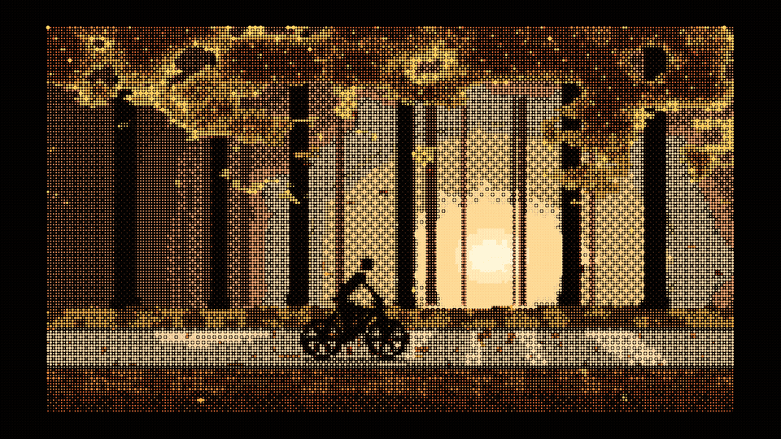

  

  <h1 align="center">Ameya Chopade</h1>
  <h3 align="center">AI Engineer &bull; Intelligent Systems &amp; GenAI Architecture</h3>

  

    &nbsp;
    &nbsp;
    &nbsp;
    
  

---

  <h3 align="center">⚡ Engineering Focus</h3>

  

    🧠 <b>GenAI &amp; Agentic Systems</b> — Architecting production-grade RAG pipelines, autonomous agent orchestration, and high-precision semantic retrieval. 
    🚀 <b>High-Throughput Services</b> — Scalable backend systems powered by FastAPI, asynchronous event queues, and Redis caching. 
    🗄️ <b>Data &amp; Vector Infrastructure</b> — Real-time vector search with Qdrant, relational data modeling in PostgreSQL, and clean ETL workflows. 
    ⚙️ <b>Production MLOps</b> — Containerized deployments with Docker, GPU acceleration (CUDA), and AWS cloud infrastructure.
  

---

  <h3 align="center">🛠️ Technical Stack</h3>

  <h4 align="center">Languages &amp; Web Core</h4>
  

    
    
    
    
    
    
    
    
    
    
    
  

  <h4 align="center">GenAI, LLMs &amp; Machine Learning</h4>
  

    
    
    
    
    
    
    
    
    
  

  <h4 align="center">Data Analytics &amp; Vector Storage</h4>
  

    
    
    
    
    
    
    
    
    
    
  

  <h4 align="center">Cloud, DevOps &amp; Platforms</h4>
  

    
    
    
    
    
    
    
    
    
  

---

  

  <h3 align="center">📊 Activity &amp; Telemetry</h3>

  

    
    
  

  

    
    
  

  

    
    
  

  

    
  

